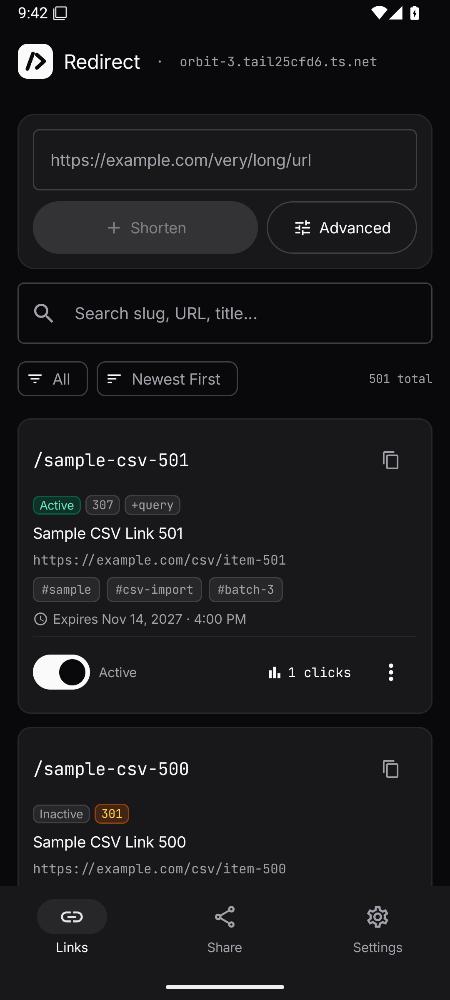
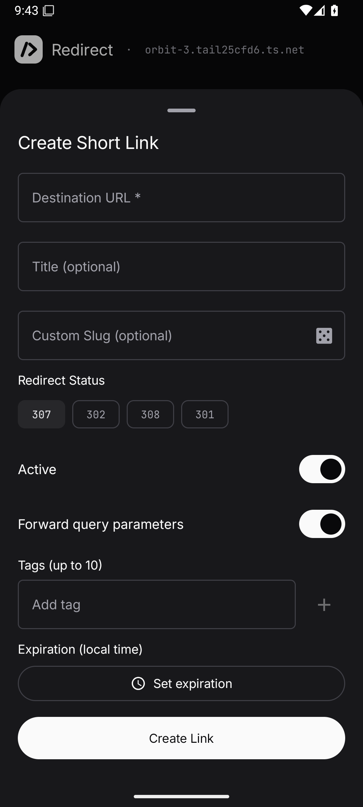
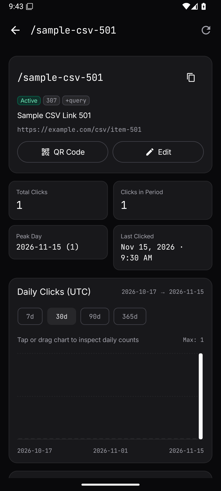

# Redirect for Android

A native Android client built with **Kotlin** and **Jetpack Compose** for the self-hosted **Redirect** URL shortener on Cloudflare Workers.

> **Companion Repository:** This app is the native Android companion client for the **Redirect** backend and web dashboard at **[github.com/azraftaohid/redirect](https://github.com/azraftaohid/redirect)**.

---

## Screenshots

| Links Dashboard | Create / Edit Link Sheet | Link Analytics |
| :---: | :---: | :---: |
|  |  |  |

---

## Features

### Link Management
- **Quick Shorten & Advanced Form:** Paste a URL to shorten and copy it in one tap, or open the full creation/edit sheet for custom slugs (with random slug generation), titles, tags (up to 10), redirect status codes (`301`, `302`, `307`, `308`), query-parameter forwarding, active status, and local-time expiration.
- **Search, Filter & Sort:** Server-backed search across slugs, destination URLs, and titles; filter by status (`All`, `Active Only`, `Inactive Only`) or tag chips; sort by newest, oldest, recently updated, most clicks, or slug (`A–Z`) with pull-to-refresh and pagination.
- **Android Share Sheet Integration:** Registered as a `text/plain` `ACTION_SEND` share target (`ShareScreen`) so URLs shared from browsers or other apps open directly in the shorten workflow, including duplicate-link detection.

### Analytics & QR Codes
- **Per-Link Analytics (`LinkStatsScreen`):** 2×2 KPI summary (Total Clicks, Clicks in Period, Peak Day, Last Clicked), an interactive **Daily Clicks (UTC)** chart (`DailyChart`) supporting `7d`, `30d`, `90d`, and `365d` ranges, plus Top Countries and Top Referrers breakdowns when enabled on the server.
- **QR Code Generation & Export:** Generate high-resolution QR codes via ZXing (`QrUtils`), save them as PNGs, or share them via Android's `FileProvider`.

### Security, Authentication & Zero Trust
- **Encrypted Credential Storage:** Server base URL, API token, and Cloudflare Zero Trust headers are persisted locally using `EncryptedSharedPreferences` backed by the Android Keystore (`AES256-GCM`).
- **Cloudflare Zero Trust Support:** Optional `CF-Access-Client-Id` and `CF-Access-Client-Secret` service token headers on every request, with automatic interception detection (`AccessSessionExpiredException`) and an in-app reconnect banner.
- **First-Time Bootstrap Helper:** Includes a one-tap server ping to bootstrap `initial_token` in Cloudflare KV and a copyable Wrangler CLI snippet for first-time setup.
- **API Token Lifecycle Management:** View, create (with optional expiration), rotate the initial token, and revoke individual or all custom KV tokens—automatically respecting principal permissions (`env` lockdown vs. `initial` vs. custom `token`).

### Data Portability (Import & Export)
- **JSON Export:** Cursor-paginated export of all links to a portable JSON file via the Android document picker.
- **Dynamic JSON & CSV Importer:** Import native Redirect v1 JSON exports or arbitrary JSON/CSV files (`DynamicImporter`, `CsvAndTimestampParser`) with automatic array-path discovery, field alias detection, customizable column/constant mapping, batch duplicate detection, conflict resolution (`skip` or `overwrite`), chunked uploads with cancel/retry support, and per-row error reporting.

### Adaptive UI
- Built with **Material Design 3**, edge-to-edge window insets, `Inter` + `JetBrains Mono` typography, and responsive layouts that switch from a bottom `NavigationBar` on phones to a `NavigationRail` on medium/expanded screens (`>= 600.dp`).

---

## Tech Stack

- **Language:** Kotlin (`2.2.10`)
- **UI:** Jetpack Compose, Material 3, Navigation Compose (type-safe `@Serializable` routes)
- **Networking & Serialization:** OkHttp (`4.10.0`), `kotlinx.serialization` (`1.8.0`)
- **Concurrency:** Kotlin Coroutines & `StateFlow` (`collectAsStateWithLifecycle`)
- **Security:** `androidx.security:security-crypto` (`EncryptedSharedPreferences`)
- **QR Generation:** Google ZXing Core (`3.5.3`)
- **Testing:** JUnit 4, Robolectric (`4.16.1`), Compose UI Test, `kotlinx-coroutines-test`

---

## Project Structure

```text
app/src/main/java/com/example/
├── MainActivity.kt                  # Edge-to-edge entry point & ACTION_SEND intent handling
├── data/
│   ├── network/RedirectApiClient.kt # OkHttp REST client for /api/v1/* endpoints
│   ├── repository/RedirectRepository.kt
│   └── storage/SecurePreferences.kt # EncryptedSharedPreferences wrapper
├── domain/
│   ├── model/Models.kt              # Serializable API models & DTOs
│   └── util/                        # Validation, CSV/JSON dynamic importer, QR, stats, dates
└── ui/
    ├── RedirectApp.kt               # Adaptive scaffold & type-safe NavHost
    ├── components/                  # Charts, link cards, form sheet, QR modal, banners
    ├── screens/
    │   ├── auth/                    # Server connection, Zero Trust & KV bootstrap help
    │   ├── dashboard/               # Links tab, quick-shorten, search, filter, pagination
    │   ├── share/                   # Share target & shorten-and-copy workflow
    │   ├── stats/                   # Per-link click analytics & dimension breakdowns
    │   └── settings/                # Session, token management, JSON export, CSV/JSON import
    └── theme/                       # Material 3 colors, shapes, Inter & JetBrains Mono type
```

---

## Prerequisites & Setup

1. **Deploy the Backend:** Set up a self-hosted Redirect server following the instructions in **[azraftaohid/redirect](https://github.com/azraftaohid/redirect)**.
2. **Android Toolchain:**
   - **Min SDK:** 24 (Android 7.0)
   - **Compile / Target SDK:** 36
   - **Java:** JDK 11+
   - **AGP:** `9.1.1`

### Building & Running Tests

Build the debug APK:
```bash
./gradlew assembleDebug
```

Run local JVM unit and Robolectric Compose UI tests:
```bash
./gradlew :app:testDebugUnitTest
```

### Connecting the App

1. Launch **Redirect** and enter your Worker's base URL (e.g., `https://go.example.com`).
2. Paste your `API_KEY`, `initial_token`, or a custom KV API token.
3. *(Optional)* Expand **Optional Cloudflare Zero Trust (Access)** to provide `CF-Access-Client-Id` and `CF-Access-Client-Secret` if your instance is protected by Cloudflare Access.
4. *(First-time KV setup)* If no static `API_KEY` secret is configured on your Worker, tap **Ping Server to Bootstrap** and retrieve `initial_token` from Cloudflare KV via Wrangler.

---

## Related

- **[azraftaohid/redirect](https://github.com/azraftaohid/redirect)** — Self-hosted Cloudflare Workers URL shortener backend & web frontend.
